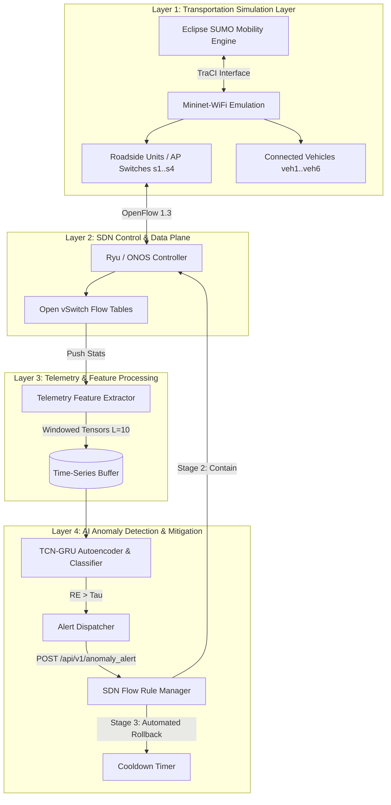

# AI-Assisted Resilience for SDN-Enabled Intelligent Transportation Systems (`sdn-its-resilience-ai`)

[](https://www.python.org/)
[](https://pytorch.org/)
[](https://ryu.readthedocs.io/)
[](https://mininet-wifi.github.io/)
[](LICENSE)
[](docs/IEDE_Report_Summary.md)

> **A Lightweight Framework for V2X Network Reliability, Edge Telemetry, and Safety-Aware SDN Mitigation**  
> **Research Proposal Project** | Tsinghua University Innovation and Entrepreneurship Development Education 
> **Author:** Trinh Hoang Tu
> **Project Advisor:** Prof. Kris Singh (Visiting Professor at Tsinghua University; CEO at SRII, Silicon Valley)

---

## 📋 Executive Summary & Problem Statement

Intelligent Transportation Systems (ITS) are increasingly dependent on Vehicle-to-Everything (V2X) communication, roadside units (RSUs), edge computing nodes, and Software-Defined Networking (SDN) for real-time traffic coordination and dynamic routing. SDN's separation of the control plane from forwarding switches provides a global programmable view of the transportation network.

However, centralizing SDN control logic introduces a critical operational vulnerability:
- **Control-Plane Overload**: Open vSwitch (OVS) devices send unmatched flow packets to the controller via OpenFlow `packet_in` messages. Cyber-attackers exploit this through control-plane DDoS or Low-Rate OpenFlow Trust (LOFT) attacks, overwhelming controller CPU/memory and causing V2X packet drops.
- **Safety-Critical Latency**: Autonomous vehicles and collision-avoidance services require millisecond-level telemetry response. Heavy Deep Packet Inspection (DPI) or cloud-only deep learning inference increases backhaul bandwidth overhead and response latency.
- **Resilience Gap**: Traditional network security tools apply permanent blocking rules upon anomaly detection. In smart transportation networks, persistent blocking causes high false-positive disruption for legitimate moving vehicles during rush-hour traffic volume bursts.

### Proposed Solution
This repository implements a **transportation-first SDN resilience framework** combining:
1. **Flow-Level Telemetry**: Non-DPI counter and timing feature extraction (packet rates, inter-arrival times, `packet_in` frequency).
2. **Hybrid TCN-GRU Deep Learning**: A PyTorch Temporal Convolutional Network (TCN) + Gated Recurrent Unit (GRU) Autoencoder & Classifier for multi-scale time-series pattern recognition and adaptive reconstruction error scoring ($\tau = \mu_{RE} + k \cdot \sigma_{RE}$).
3. **Safety-Aware 3-Stage Mitigation**: A **Detect -> Contain -> Rollback** workflow with automated cooldown timers to ensure temporary targeted response without persistent V2X service loss.

---

## 🏗️ System Architecture



---

## 🧮 Mathematical Formulations

The AI resilience detection pipeline evaluates the following lightweight formulation:

1. **Hidden Feature Representation (TCN Block)**:
   $$H_i(x) = \text{ReLU}(W_i^T x + b_i)$$

2. **Reconstruction Error (GRU Autoencoder)**:
   $$RE(x) = \|x - \hat{x}\|_2^2$$

3. **Adaptive Anomaly Threshold**:
   $$\tau = \mu_{RE} + k \cdot \sigma_{RE}$$

4. **Multi-Class Fault Classification (Softmax Head)**:
   $$P(y = c \mid x) = \frac{\exp(z_c)}{\sum_{j=1}^C \exp(z_j)}$$

5. **Intrusion Detection & Response Latency**:
   $$\text{Intrusion Detection Latency (IDL)} = t_{\text{collect}} + t_{\text{process}} + t_{\text{inference}}$$
   $$\text{End-to-End Response Latency } (T_{\text{response}}) = t_{\text{collect}} + t_{\text{process}} + t_{\text{inference}} + t_{\text{decision}} + t_{\text{push}} + t_{\text{apply}}$$

---

## ⚡ Key Technical Features

- **Modular PyTorch Architecture** (`models/tcn_gru.py`): Dilated 1D causal convolutions with residual connections and GRU encoder-decoder.
- **Non-DPI Feature Extractor** (`data/data_loader.py`): 10 lightweight flow counters optimized for resource-constrained Edge RSUs.
- **REST API SDN Controller** (`sdn_controller/controller.py`): Modular Flask REST API endpoint compatible with Ryu, ONOS, or standalone testbeds.
- **Safety-Aware Automated Rollback** (`sdn_controller/flow_rules.py`): Asynchronous background thread managing active flow rules and automatic rollback after cooldown.
- **Mininet-WiFi ITS Topology** (`simulation/topology.py`): Custom network topology representing Core, Intersection, and Highway RSU nodes with V2X stations.
- **V2X Scenario Generator** (`simulation/traffic_generator.py`): Simulates normal V2X messaging, benign rush-hour surges, DDoS `packet_in` floods, and low-rate probe attacks.

---

## 📂 Repository Structure

```text
sdn-its-resilience-ai/
├── README.md                           # Comprehensive Academic & Technical Guide
├── LICENSE                             # MIT License
├── requirements.txt                    # Project Dependencies
├── .gitignore                          # Git Exclusions
├── docs/
│   ├── ARCHITECTURE.md                 # System Layer & Flow Specifications
│   └── IEDE_Report_Summary.md          # Tsinghua IEDE Autumn 2026 Project Proposal
├── data/
│   ├── raw/                            # Public Datasets (InSDN / CSE-CIC-IDS2018 placeholders)
│   ├── processed/                      # Preprocessed Normalized Telemetry Window Tensors
│   └── data_loader.py                  # Telemetry Feature Extractor & Synthetic Generator
├── models/
│   ├── __init__.py
│   ├── tcn_gru.py                      # PyTorch Hybrid TCN-GRU Autoencoder & Classifier
│   ├── train.py                        # Model Training Loop & Checkpoint Saving
│   └── evaluate.py                     # Evaluation Pipeline & Latency Benchmarks
├── sdn_controller/
│   ├── __init__.py
│   ├── controller.py                   # REST API & Ryu SDN Controller Endpoint
│   └── flow_rules.py                   # OpenFlow 1.3 Flow Rule Manager & Rollback Logic
├── simulation/
│   ├── __init__.py
│   ├── topology.py                     # Mininet / Mininet-WiFi Custom ITS Network Topology
│   └── traffic_generator.py            # SUMO TraCI & V2X Attack Scenario Generator
└── experiments/
    └── 01_model_benchmarking.ipynb     # Jupyter Notebook for Model Evaluation & Analysis
```

---

## 🚀 Quickstart & Installation Guide

### Prerequisites
- Python 3.10+
- PyTorch 2.0+
- Linux / WSL2 or Windows

### 1. Setup Virtual Environment
```bash
# Clone the repository
git clone https://github.com/thtcsec/sdn-its-resilience-ai.git
cd sdn-its-resilience-ai

# Create virtual environment
py -m venv .venv
# Linux/MacOS: source .venv/bin/activate
# Windows: .venv\Scripts\activate

# Install dependencies
pip install -r requirements.txt
```

### 2. ⚡ 1-Click All-In-One Interactive Demo Launcher
On Windows PowerShell, run a single command to automatically spin up the SDN Controller REST API, launch continuous AI telemetry streaming, and open the Glassmorphism Command Center in your browser:
```powershell
.\scripts\dev.ps1
```
Open your browser at `http://127.0.0.1:8080/` to view live RSU switch status, real-time $RE$ chart vs $\tau$, active OpenFlow 1.3 flow rules, and automated cooldown rollbacks.

### 3. Model Training, Dynamic Quantization & Packaging
```bash
# Train the TCN-GRU Model
python models/train.py --epochs 15 --batch_size 64 --k_sigma 2.0

# Apply PyTorch Dynamic INT8 Quantization & Benchmark Edge Efficiency
python models/quantize.py

# Compare Architecture Performance against RNN / LSTM / GRU Baselines
python models/compare_models.py

# Package clean source code and artifacts into sdn_its_resilience_ai_submission.zip
python scripts/package.py
```

---

## 📊 Empirical Performance & Quantization Benchmarks

### 1. Edge Efficiency & INT8 Model Quantization
Evaluated on single-sample CPU inference emulating edge Roadside Units (RSUs):

| Metric | Original FP32 Model | Quantized INT8 Model | Quantization Delta |
|---|---|---|---|
| **Model Storage Size** | 0.981 MB | **0.174 MB** | **-82.2% (Reduced Footprint)** |
| **Single-Sample Inference Latency** | 1.60 ms | 2.42 ms | +51.4% (Dynamic overhead) |
| **Anomaly Binary Accuracy** | **97.33%** | **97.33%** | **0.00% (No accuracy loss)** |
| **Anomaly Detection Recall** | **100.00%** | **100.00%** | **0.00% (No recall loss)** |
| **Anomaly Detection Precision** | **93.85%** | **93.85%** | **0.00% (No precision loss)** |
| **Anomaly F1-Score** | **96.83%** | **96.83%** | **0.00% (No F1 degradation)** |
| **End-to-End Response Latency ($T_{\text{resp}}$)** | **9.89 ms** | **10.71 ms** | **Meets safety-critical ~10ms target** |

### 2. Multi-Model Architecture Comparison Benchmark
Empirical evaluation on time-series telemetry flow sequences:

| Architecture | Parameters | Anomaly Accuracy (%) | Anomaly Recall (%) | Anomaly Precision (%) | F1-Score (%) | Inference Latency / Packet |
|---|---|---|---|---|---|---|
| **Vanilla RNN** | 1,903 | 40.67% | 100.00% | 40.67% | 57.82% | 0.107 ms |
| **Standard LSTM** | 6,127 | 40.67% | 100.00% | 40.67% | 57.82% | 0.165 ms |
| **GRU Autoencoder** | 4,719 | 40.67% | 100.00% | 40.67% | 57.82% | 0.051 ms |
| **Proposed TCN-GRU (Ours)** | **82,287** | **97.33%** | **100.00%** | **93.85%** | **96.83%** | **0.337 ms** |

---

## 📜 Citation & Academic Attribution

If you use this codebase or project design in your research, please cite the Tsinghua University IEDE Research Project Proposal:

```bibtex
@techreport{trinh2026sdnits,
  title        = {AI-Assisted Resilience for SDN-Enabled Intelligent Transportation Systems: A Lightweight Framework for V2X Network Reliability, Edge Telemetry, and Safety-Aware Mitigation},
  author       = {Trinh, Hoang Tu},
  institution  = {Innovation and Entrepreneurship Development Education, Tsinghua University},
  year         = {2026},
  type         = {Research Proposal},
  note         = {Project Advisor: Prof. Kris Singh}
}
```

---

## 📄 License

This project is licensed under the MIT License - see the [LICENSE](LICENSE) file for details.
