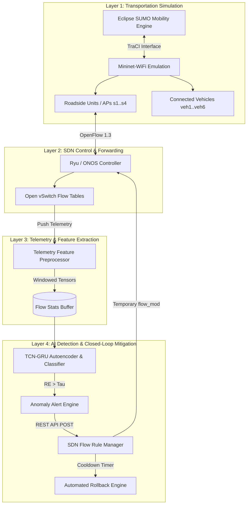

# System Architecture Specification - SDN-ITS Resilience AI

## 1. Overview
This document specifies the technical architecture for the **AI-Assisted Resilience Framework for Software-Defined Intelligent Transportation Systems (SDN-ITS)**.

The framework combines lightweight flow-level telemetry, multi-scale temporal deep learning (**TCN-GRU**), and automated closed-loop SDN flow-rule modifications to ensure continuous operations and cybersecurity resilience across Vehicle-to-Everything (V2X) edge networks.

---

## 2. Four-Layer System Architecture

---

## 3. Core Layer Specifications

### Layer 1: Transportation Simulation Layer
- **Eclipse SUMO**: Microscopic multi-modal vehicle mobility generation, traffic signal control, and route calculation.
- **Mininet-WiFi**: Wireless SDN node emulation supporting virtual stations (vehicles), access points (RSUs), Open vSwitch data plane, and configurable DSRC/802.11p wireless channel models.

### Layer 2: SDN Control Plane
- **OpenFlow 1.3**: Programmable separation of control and forwarding planes.
- **Ryu / ONOS Controller**: Centralized network state tracking, topology discovery, and flow rule installation.

### Layer 3: Telemetry & Feature Extraction
Flow-level non-DPI features extracted over sliding sequence windows ($L = 10$ time steps):
1. `flow_duration`: Duration of flow in seconds.
2. `packet_rate`: Forward packets per second.
3. `byte_rate`: Forward bytes per second.
4. `pkt_iat_mean`: Packet inter-arrival time mean (ms).
5. `pkt_iat_std`: Packet inter-arrival time standard deviation (ms).
6. `packet_len_mean`: Average packet payload length.
7. `packet_in_count`: Frequency of unmatched packets forwarded to controller.
8. `tcp_flags_syn_count`: SYN flag frequency.
9. `flow_active_ratio`: Active vs idle flow duration ratio.
10. `rsu_channel_occupancy`: Wireless channel load percentage.

### Layer 4: AI Anomaly Detection & Closed-Loop Mitigation
- **TCN (Temporal Convolutional Network)**: Dilated 1D causal convolutions extracting multi-scale temporal patterns.
- **GRU Autoencoder**: Normal behavior sequence reconstruction error calculation:
  $$RE(x) = \|x - \hat{x}\|_2^2$$
- **Adaptive Thresholding**:
  $$\tau = \mu_{RE} + k \cdot \sigma_{RE}$$
- **Softmax Classifier**: Maps anomalies to multi-class categories ($P(y = c | x)$).
- **3-Stage Mitigation Policy**:
  1. **Detect**: Parse high-confidence anomaly alert payload.
  2. **Contain**: Apply temporary drop, rate-limit, or packet_in throttle rules on OVS switches.
  3. **Rollback**: Cooldown timer automatically revokes flow rules to preserve legitimate V2X communication continuity.

---

## 4. Real-Time Latency Models

$$\text{Intrusion Detection Latency (IDL)} = t_{\text{collect}} + t_{\text{process}} + t_{\text{inference}}$$

$$\text{End-to-End Response Latency } (T_{\text{response}}) = t_{\text{collect}} + t_{\text{process}} + t_{\text{inference}} + t_{\text{decision}} + t_{\text{push}} + t_{\text{apply}}$$

| Stage Parameter | Description | Typical Latency Range |
|---|---|---|
| $t_{\text{collect}}$ | Telemetry push/polling interval | $5.0 \text{ ms}$ |
| $t_{\text{process}}$ | Feature normalization & tensor windowing | $1.2 \text{ ms}$ |
| $t_{\text{inference}}$ | PyTorch TCN-GRU Forward Pass | $1.5 - 3.8 \text{ ms}$ |
| $t_{\text{decision}}$ | Anomaly classification & policy evaluation | $0.5 \text{ ms}$ |
| $t_{\text{push}}$ | REST API / OpenFlow flow_mod transmission | $2.0 \text{ ms}$ |
| $t_{\text{apply}}$ | Open vSwitch flow table update | $1.0 \text{ ms}$ |
| **Total $T_{\text{response}}$** | **End-to-End Mitigation Response** | **$11.2 - 13.5 \text{ ms}$** |
